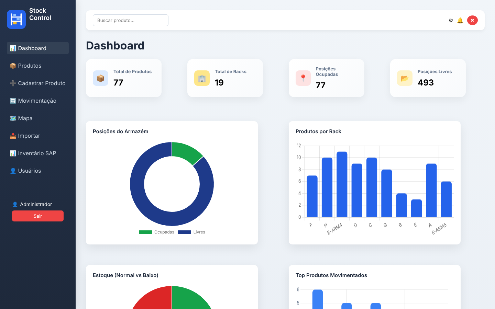
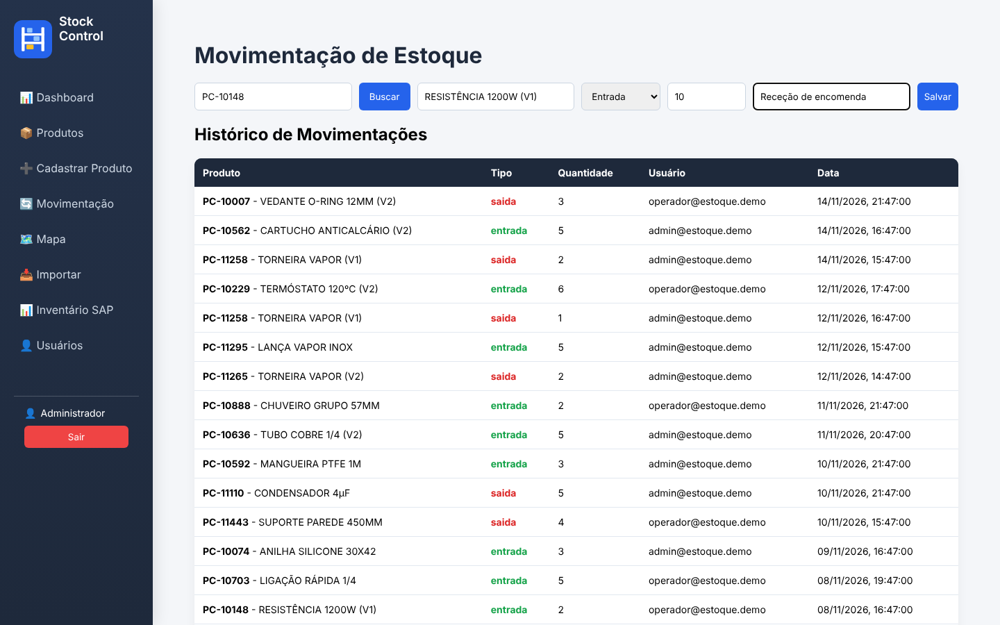
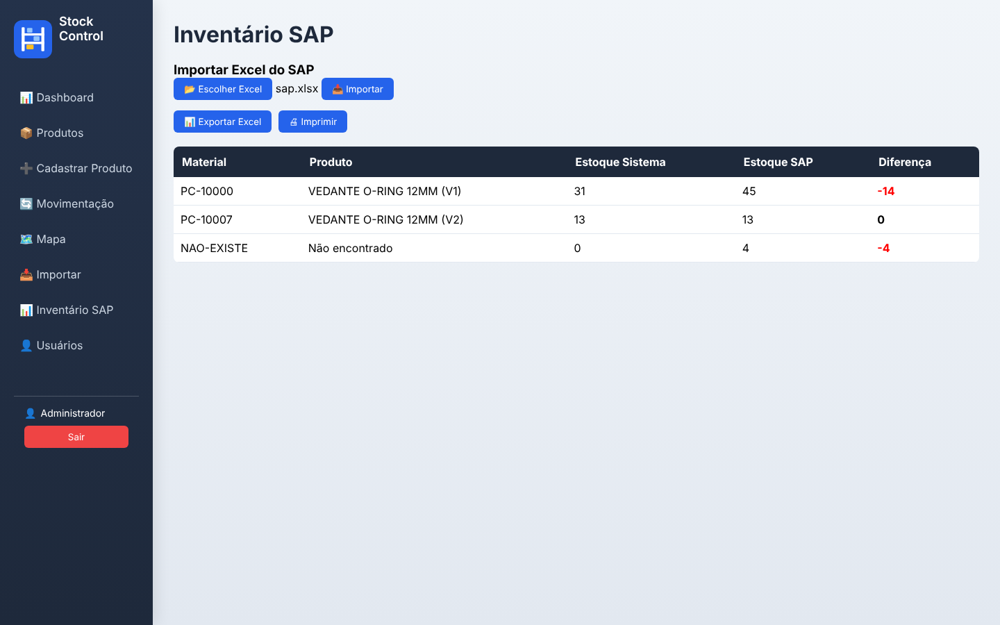

# StockControl · Controle de Estoque

Sistema web para gerir o stock de um armazém de peças: **mapa de racks e níveis, entradas e saídas, importação de Excel e conferência com o relatório do SAP**. Back-end próprio em Node.js com API REST, autenticação JWT e base de dados SQL.

> Empresa e dados fictícios, criados para demonstração. O projeto nasceu da minha experiência real no controlo de stock de um armazém.



## Experimentar em 1 minuto

Precisa do **Node.js 22.13 ou mais recente**.

```bash
git clone https://github.com/AndersonFrotaGoncalves/controle-estoque.git
cd controle-estoque
npm install
npm start
```

Abra **http://localhost:3000** e entre com uma das contas de demonstração (também há botões no ecrã de login):

| Conta | E-mail | Senha | Pode |
|---|---|---|---|
| Administrador | `admin@estoque.demo` | `admin123` | tudo |
| Operador | `operador@estoque.demo` | `operador123` | consultar e registar movimentações |

No primeiro arranque é criada uma base SQLite com 77 produtos e 2 meses de movimentações. Para começar do zero: `npm run reset-db`.

## Funcionalidades

- **Dashboard:** total de produtos, ocupação das posições, produtos por rack, stock normal vs. baixo e produtos mais movimentados
- **Mapa do armazém:** cada rack com os seus níveis, as posições ocupadas e pesquisa por código
- **Produtos:** listagem, criação, edição e exclusão (só administradores), com código único validado no servidor
- **Movimentações:** procurar a peça pelo código (ou leitor de código de barras + Enter) e registar entradas e saídas. **Não é possível deixar o stock negativo**
- **Importar Excel:** cria os códigos novos e atualiza os que já existem, com relatório de linhas com erro
- **Inventário SAP:** carrega o relatório do SAP e mostra, para cada material, a diferença entre o stock do sistema e o do SAP
- **Utilizadores:** gestão de contas e permissões (admin ou operador)

Na pasta [`exemplos/`](exemplos) há duas folhas de Excel para testar a importação e a conferência com o SAP.

| Movimentações | Conferência com o SAP |
|---|---|
|  |  |


## Arquitetura

```
backend/
  server.js              # Express: API + ficheiros do frontend
  db.js                  # SQLite (por omissão) ou MySQL, com a mesma interface
  schema.sql             # tabelas: usuarios, produtos, movimentacoes
  schema.mysql.sql       # equivalente para MySQL
  seed.js                # dados de demonstração (fictícios)
  middleware/
    authMiddleware.js    # verificação do JWT e permissão de administrador
  routes/
    auth.js              # POST /auth/login
    produtos.js          # CRUD /api/produtos
    movimentacoes.js     # /api/movimentacoes
    importar.js          # POST /importar (Excel → produtos)
    sap.js               # POST /api/sap (lê o relatório do SAP)
    usuarios.js          # CRUD /usuarios
frontend/
  *.html, css/, js/      # páginas em HTML, CSS e JavaScript sem framework
  js/proteger.js         # guarda de sessão: envia o token e trata a expiração
```

### API

| Método | Rota | Acesso | Descrição |
|---|---|---|---|
| POST | `/auth/login` | público | devolve o token JWT (8 h) |
| GET | `/api/produtos` | autenticado | lista de produtos |
| GET | `/api/produtos/codigo/:codigo` | autenticado | procura por código |
| POST · PUT · DELETE | `/api/produtos[/:id]` | admin | criar, editar, excluir |
| GET · POST | `/api/movimentacoes` | autenticado | histórico e nova entrada/saída |
| POST | `/api/sap` | autenticado | lê o Excel do SAP |
| POST | `/importar` | admin | importa produtos de Excel/CSV |
| GET · POST · PUT · DELETE | `/usuarios[/:id]` | admin | gestão de utilizadores |

### Decisões técnicas

- **Stock nunca negativo, mesmo com pedidos em simultâneo.** A saída é um único `UPDATE … WHERE quantidade >= ?`, por isso duas saídas ao mesmo tempo não passam do stock disponível. A base de dados tem também um `CHECK (quantidade >= 0)`.
- **Autenticação JWT em todas as rotas** exceto o login. O utilizador de cada movimentação vem do token, não do formulário, para não poder ser falsificado.
- **Senhas com bcrypt.** O login dá a mesma mensagem para e-mail inexistente e senha errada, para não revelar que contas existem.
- **Sem configuração para experimentar:** usa o SQLite incluído no Node. Em produção, basta definir as variáveis `MYSQL*` para usar MySQL (ver [`.env.example`](.env.example)).
- **Uploads em memória:** os ficheiros Excel não ficam guardados no servidor.

## Tecnologias

Node.js · Express · SQLite / MySQL · JWT · bcrypt · Multer · SheetJS · HTML · CSS · JavaScript · Chart.js

## Autor

**Anderson Frota** · [andersonfrota.netlify.app](https://andersonfrota.netlify.app) · [LinkedIn](https://www.linkedin.com/in/andersongfrota) · [GitHub](https://github.com/AndersonFrotaGoncalves)
