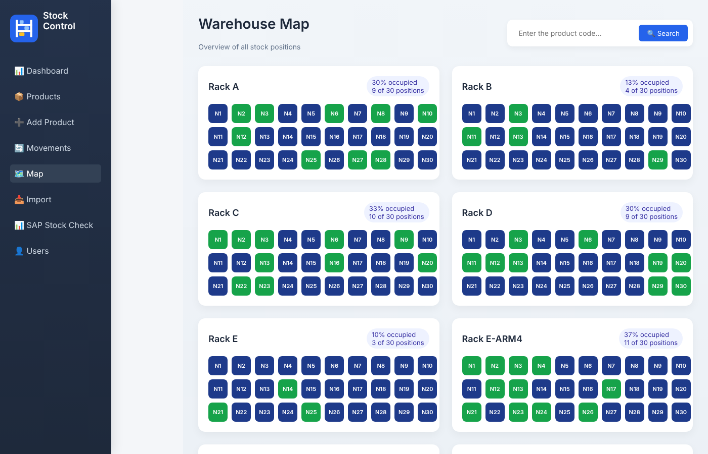

# StockControl · Inventory Management

Web system to manage stock in a parts warehouse: **rack and level map, stock in/out movements, Excel import and stock check against the SAP report**. Custom Node.js back end with a REST API, JWT authentication and a SQL database.

🔗 **Live demo:** [controle-estoque-6d0g.onrender.com](https://controle-estoque-6d0g.onrender.com) · sign in with the *Administrator* or *Operator* button. On the free plan, the first visit can take about 50 seconds while the server wakes up.

> The company and data are fictional, created for this demo. The project comes from my real experience managing stock in a warehouse.


## Try it in 1 minute

You need **Node.js 22.13 or newer**.

```bash
git clone https://github.com/AndersonFrotaGoncalves/controle-estoque.git
cd controle-estoque
npm install
npm start
```

Open **http://localhost:3000** and sign in with one of the demo accounts (there are also buttons on the login screen):

| Account | Email | Password | Can |
|---|---|---|---|
| Administrator | `admin@estoque.demo` | `admin123` | everything |
| Operator | `operador@estoque.demo` | `operador123` | view and record movements |

On first start, a SQLite database is created with 77 products and 2 months of movements. To start from scratch: `npm run reset-db`.

## Deploy online (Render, free)

The repository includes a [`render.yaml`](render.yaml). On [Render](https://render.com): **New → Blueprint**, choose this repository and click **Apply**. Render installs it, generates the `JWT_SECRET` and deploys on every push. On the free plan, the demo database is recreated on every deploy or restart.

## Features

- **Dashboard:** total products, position occupancy, products per rack, normal vs. low stock and most moved products
- **Warehouse map:** each rack with its levels, occupied positions and search by code
- **Products:** list, create, edit and delete (administrators only), with a unique code checked on the server
- **Movements:** find the part by code (or with a barcode scanner + Enter) and record stock in and stock out. **Stock can never go below zero**
- **Excel import:** creates new codes and updates existing ones, with a report of rows that have errors
- **SAP stock check:** loads the SAP report and shows, for each material, the difference between the system stock and the SAP stock
- **Users:** manage accounts and roles (admin or operator)

The [`examples/`](examples) folder has two Excel files to test the import and the SAP stock check.

| Movements | SAP stock check |
|---|---|
|  |  |



## Architecture

```
backend/
  server.js              # Express: API + front-end files
  db.js                  # SQLite (default) or MySQL, with the same interface
  schema.sql             # tables: usuarios (users), produtos (products), movimentacoes (movements)
  schema.mysql.sql       # MySQL equivalent
  seed.js                # demo data (fictional)
  middleware/
    authMiddleware.js    # JWT check and admin permission
  routes/
    auth.js              # POST /auth/login
    produtos.js          # CRUD /api/produtos
    movimentacoes.js     # /api/movimentacoes
    importar.js          # POST /importar (Excel → products)
    sap.js               # POST /api/sap (reads the SAP report)
    usuarios.js          # CRUD /usuarios
frontend/
  *.html, css/, js/      # pages in HTML, CSS and plain JavaScript
  js/proteger.js         # session guard: sends the token and handles expiry
```

### API

| Method | Route | Access | Description |
|---|---|---|---|
| POST | `/auth/login` | public | returns the JWT token (8 h) |
| GET | `/api/produtos` | signed in | product list |
| GET | `/api/produtos/codigo/:codigo` | signed in | find by code |
| POST · PUT · DELETE | `/api/produtos[/:id]` | admin | create, edit, delete |
| GET · POST | `/api/movimentacoes` | signed in | history and new stock in/out |
| POST | `/api/sap` | signed in | reads the SAP Excel file |
| POST | `/importar` | admin | imports products from Excel/CSV |
| GET · POST · PUT · DELETE | `/usuarios[/:id]` | admin | user management |

### Technical decisions

- **Stock never below zero, even with simultaneous requests.** Stock out is a single `UPDATE … WHERE quantidade >= ?`, so two requests at the same time can't take more than the available stock. The database also has a `CHECK (quantidade >= 0)`.
- **JWT authentication on every route** except login. The user of each movement comes from the token, not from the form, so it can't be faked.
- **Passwords hashed with bcrypt.** Login gives the same message for an unknown email and a wrong password, so it doesn't reveal which accounts exist.
- **No setup to try it:** it uses the SQLite built into Node. In production, set the `MYSQL*` variables to use MySQL (see [`.env.example`](.env.example)).
- **Uploads in memory:** Excel files are never stored on the server.
- **The importers accept English and Portuguese column names** (the original SAP exports are in Portuguese).

## Tech stack

Node.js · Express · SQLite / MySQL · JWT · bcrypt · Multer · SheetJS · HTML · CSS · JavaScript · Chart.js

## Author

**Anderson Frota** · [andersonfrota.netlify.app](https://andersonfrota.netlify.app) · [LinkedIn](https://www.linkedin.com/in/andersongfrota) · [GitHub](https://github.com/AndersonFrotaGoncalves)
